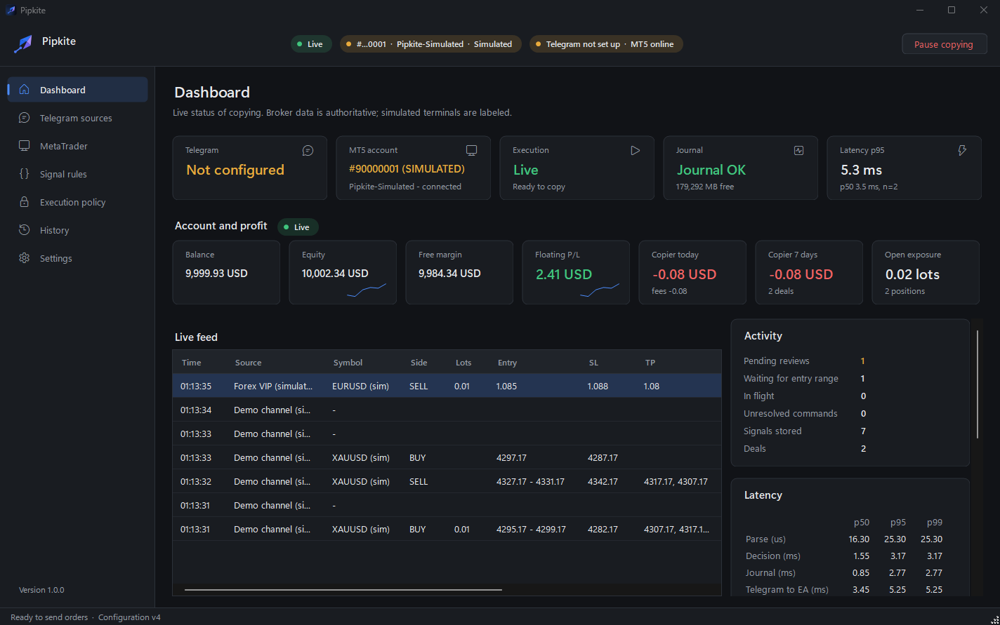

# Pipkite

Pipkite copies trading signals from Telegram to MetaTrader 5 for you. When a channel you follow posts
"GOLD BUY 4299, SL 4282, TP 4307", Pipkite reads it, checks it against your rules and places the order in your
MT5 terminal, in about 4 ms. Free for everyone, including the AI review of every signal.

**Website: [pipkite.com](https://pipkite.com)** · [Download](https://github.com/ImMrHak/Pipkite/releases/latest) · [Free license key](https://pipkite.com/license) · [User guide](docs/USER-GUIDE.md)



## What it does

- **Reads your Telegram channels.** It signs in with your own Telegram account, so private channels and groups
  work too. Only new messages are copied, never old ones.
- **Understands the signals.** Pipkite comes with formats that read most signal styles: many languages, emojis,
  entry ranges, several take-profits. If none fits a channel, show Pipkite one signal and it learns it, or let the
  AI suggest a format.
- **Follows your rules.** Lot size or risk %, max spread, trading hours, entry ranges, daily loss limits.
- **Places the order in MT5.** Through the Pipkite EA (a small add-on inside MetaTrader). Your broker password
  stays in MetaTrader.
- **Gives a second opinion.** An AI rates each signal Good, Uncertain or Bad, with the reasons. It's advice only.
- **Stops in one click.** Pause copying any time. Pausing never closes your open trades.

## How it works

```
Telegram message  ->  Pipkite reads it  ->  checks your rules  ->  order in MetaTrader 5  ->  your broker
```

Everything runs on your Windows PC. There's no cloud server between you and your broker.

## What you need

- A Windows 10 or 11 PC (64-bit). For copying 24/7, a Windows VPS.
- MetaTrader 5 (desktop) from your broker. **Start with a demo account.**
- A Telegram account that's a member of the channels you want to copy.
- A free Telegram API ID and hash from [my.telegram.org](https://my.telegram.org) (takes a minute).
- A free Pipkite license key from [pipkite.com/license](https://pipkite.com/license).

## Get started

1. **Install.** Download the installer from [pipkite.com](https://pipkite.com/download) or
   [GitHub Releases](https://github.com/ImMrHak/Pipkite/releases/latest) and run it. No admin rights needed. If
   Windows shows a SmartScreen warning, click **More info**, then **Run anyway**.
2. **Add your license key.** The setup wizard opens on first launch. Paste your key and click **Validate & save**.
3. **Connect Telegram.** Enter your API ID and hash, then your phone number and the code Telegram sends you.
   Tick the channels to copy.
4. **Connect MetaTrader 5.** Click **Start MetaTrader**, log in to your broker (demo first), then click
   **Approve pairing** and type your account number.
5. **Pick each channel's format.** On **Signal rules**, select a channel and click **Detect format**. Pick the
   format that reads its signals right. None does? Teach Pipkite with one signal, or click **Ask AI for a format**.
6. **Check, then start.** The channel's first signals show in **History** with what Pipkite would do. When they
   look right, click **Start copying**.
7. **Set your rules** on **Execution policy**: lot size or risk %, and a max spread for every symbol you trade.

The full walk-through with screenshots is in the [user guide](docs/USER-GUIDE.md).

## Good to know

- **Use a demo account first.** Once an account is paired and a channel is started, signals are traded for real.
- **No copier can guarantee fills or profits,** and the AI review can be wrong.
- **Your PC must stay on.** Sleep, shutdown or a closed MetaTrader pause copying.
- **Your data stays on your PC:** history, settings and your Telegram session (encrypted). The website's
  [privacy page](https://pipkite.com/privacy) lists exactly what the online services receive.

## Common problems

| You see | What to do |
|---|---|
| Telegram: not set up | Enter your API ID and hash, then sign in. |
| MT5 offline | Click **Start MetaTrader**. If MT5 is already open, close it first. |
| A signal shows **Unsupported** | That channel has no format yet: **Detect format** on Signal rules. |
| A signal shows **Rejected** or **Review** | Open it in History to see why. Nothing was sent. |
| "New format for this channel, not copied yet" | Check the reading, then **Start copying** on Signal rules. |

More in the [user guide](docs/USER-GUIDE.md#something-wrong). Settings also has **Run health check**.

## Build from source

You need Visual Studio 2026 (C++ desktop + C++/CLI + .NET Framework 4.8 targeting pack).

```powershell
# app, engine, EA bridge, tests (Release x64)
MSBuild Pipkite.sln -p:Configuration=Release -p:Platform=x64 -m
x64\Release\Pipkite.Tests.exe

# installer + portable zip (needs Inno Setup)
powershell -ExecutionPolicy Bypass -File installer\package.ps1 -Build
```

Or open `Pipkite.sln` and press F5. More in [docs/DEVELOPMENT.md](docs/DEVELOPMENT.md).

## Repo layout

| Folder | What's in it |
|---|---|
| `Pipkite.WinForms` | the desktop UI |
| `Pipkite.Engine` | the engine: Telegram, parsing, decisions, orders, updates |
| `Pipkite.Core` | parser, signal formats, rules, planner, AI client |
| `Pipkite.Storage` | local SQLite database and backups |
| `Pipkite.Protocol` | IPC, crypto, signing |
| `Pipkite.MT5BridgeHost` / `MT5BridgeImpl` | the DLL the EA talks to |
| `mql5/` | the MetaTrader 5 EA |
| `Pipkite.Tests` | tests (unit + end-to-end with a test MT5 terminal) |
| `config/templates/` | the built-in signal formats, as JSON |
| `frontend/` | the website |

## Contributing

Issues and pull requests are welcome. Keep changes small, run the tests before sending, and don't commit keys,
secrets or local data. Have an idea? [Open an issue](https://github.com/ImMrHak/Pipkite/issues).

Using an AI coding assistant? Point it at [AGENTS.md](AGENTS.md). Claude Code picks it up by itself, plus the
`pipkite-contribute` skill in `.claude/skills/` with recipes for common changes.

## License

Copyright (C) 2026 Mohamed Hakkou & Yassine Belouchi. GPL-3.0, see [LICENSE](LICENSE): you can use, study, change
and share Pipkite, and any copy you distribute, changed or not, must stay open source under the same license.

The Pipkite name and logo are not covered by the license. If you publish a modified version, give it a different
name and logo.

Third-party notices: [third_party/THIRD_PARTY_NOTICES.md](third_party/THIRD_PARTY_NOTICES.md).
