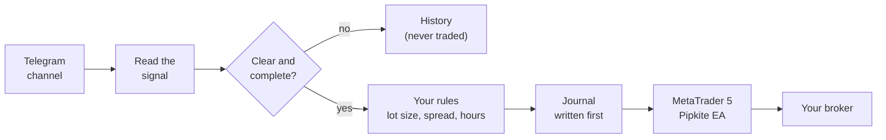
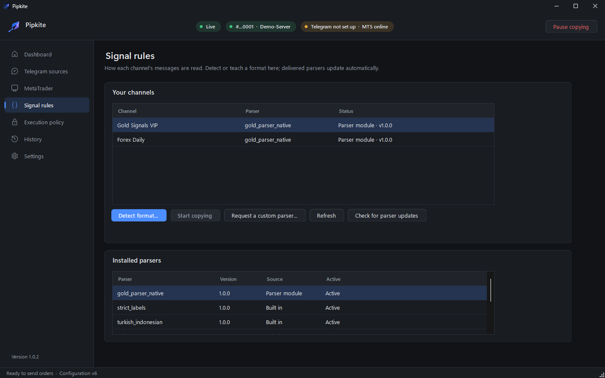
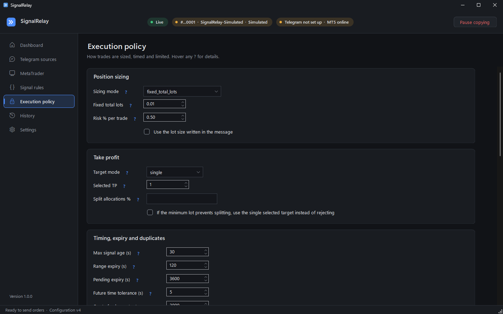
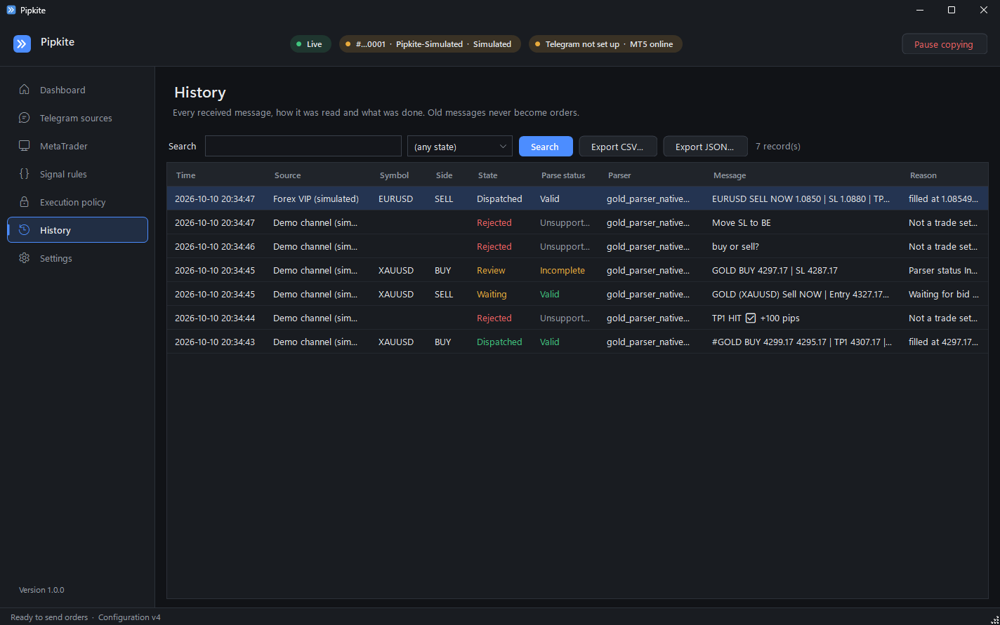
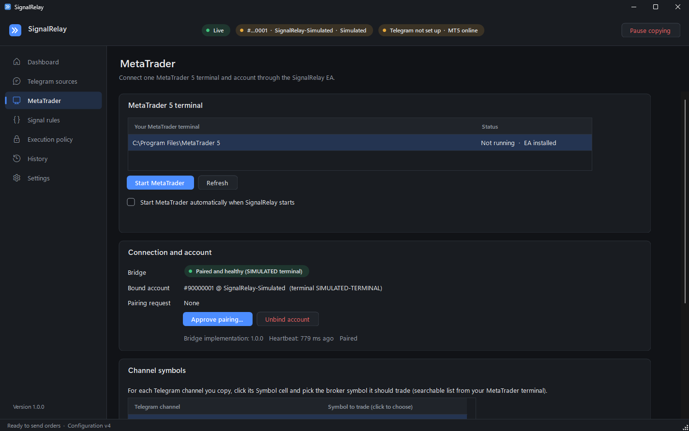

<div align="center">

<picture>
  <source media="(prefers-color-scheme: dark)" srcset="brand/svg/pipkite-logo-on-dark.svg">
  
</picture>

### Copy trading signals from Telegram to MetaTrader 5, safely and in milliseconds.

Free and open source. Runs on your own Windows PC.

[](https://github.com/ImMrHak/Pipkite/releases/latest)
[](https://github.com/ImMrHak/Pipkite/releases)
[](LICENSE)
[](#requirements)
[](#requirements)

**[Website](https://pipkite.com)** · **[Download](https://github.com/ImMrHak/Pipkite/releases/latest)** · **[Free license key](https://pipkite.com/license)** · **[User guide](docs/USER-GUIDE.md)** · **[Changelog](CHANGELOG.md)**


</div>

## What is Pipkite?

When a Telegram channel you follow posts a signal like this:

```text
GOLD BUY 4299 - 4295
SL 4282
TP1 4307  TP2 4320
```

Pipkite reads it, checks it against your rules and places the order in your MetaTrader 5 terminal, in about
**4 ms** on a normal PC. If anything in the message is missing or unclear, it doesn't guess: the signal goes to
History for you to check, and nothing is traded.

## Features

|  |  |
|---|---|
| 📡 **Reads your Telegram channels** | Signs in with your own Telegram account, so private channels and groups work too. Only new messages are copied. |
| 🧠 **Understands most signal styles** | Built-in formats read many languages, emojis, entry ranges and several take-profits. If none fits, teach Pipkite with one signal or let the AI suggest a format. |
| 🛡️ **Follows your rules** | Fixed lots or risk %, max spread and entry deviation per symbol, trading hours, daily loss limit, split take-profits. |
| ⚡ **Fast and crash-safe** | About 4 ms from message to order. Every order is written to a journal first, so a crash or power cut never sends it twice. |
| 🤖 **AI second opinion** | Each signal is rated Good, Uncertain or Bad, with reasons. It's advice only: the AI never places or blocks a trade. |
| ⏸️ **Stop in one click** | Pause copying any time. Pausing never closes or changes your open trades. |
| 🔒 **Signed and local** | Parsers, the MetaTrader bridge and updates are signature-checked. Your history, settings and Telegram session stay on your PC. |

## How it works



Everything runs on your Windows PC. There's no cloud server between you and your broker, and your broker
password stays inside MetaTrader.

## Screenshots

| Signal rules | Execution policy |
|---|---|
|  |  |
| **History** | **MetaTrader** |
|  |  |

## Requirements

- Windows 10 or 11, 64-bit. For copying 24/7, a Windows VPS.
- MetaTrader 5 (desktop) from your broker. **Start with a demo account.**
- A Telegram account that's a member of the channels you want to copy, and a free API ID and hash from
  [my.telegram.org](https://my.telegram.org).
- A free Pipkite license key from [pipkite.com/license](https://pipkite.com/license). It unlocks the AI review,
  shared formats and updates.

## Quick start

1. **Install.** Download the installer from [pipkite.com](https://pipkite.com/download) or
   [GitHub Releases](https://github.com/ImMrHak/Pipkite/releases/latest). No admin rights needed.
2. **Follow the setup wizard.** It opens on first launch: license key, Telegram sign-in, the channels to copy,
   then MetaTrader 5 (click **Start MetaTrader**, log in, approve the pairing).
3. **Pick each channel's format** on **Signal rules** with **Detect format**. A new format only trades after you
   check its first signals in History and click **Start copying**.
4. **Set your rules** on **Execution policy**: lot size or risk %, and limits for every symbol you trade. Common
   symbols like gold come with suggested limits you can check and save.

Each page shows a short tour the first time you open it. The full walk-through with screenshots is in the
[user guide](docs/USER-GUIDE.md).

<details>
<summary><b>Common problems</b></summary>
<br>

| You see | What to do |
|---|---|
| SmartScreen warning on install | Click **More info**, then **Run anyway**. Check the file against the SHA-256 on the download page. |
| Telegram: not set up | Enter your API ID and hash, then sign in. |
| MT5 offline | Click **Start MetaTrader**. If MT5 is already open, close it first. |
| A signal shows **Unsupported** | That channel has no format yet: **Detect format** on Signal rules. |
| A signal shows **Rejected** or **Review** | Open it in History to see why. Nothing was sent. |
| "Symbol limits are not configured" | Pick the symbol under **Symbol limits** on Execution policy and give it a max spread. |
| "New format for this channel, not copied yet" | Check the reading, then **Start copying** on Signal rules. |

More in the [user guide](docs/USER-GUIDE.md#something-wrong). Settings also has **Run health check**.

</details>

## Safety first

Pipkite places real orders with real money, so a few rules are built in and never loosened:

- **No trade without symbol, side, entry (or NOW), stop-loss and take-profit**, all read with no conflict.
  Pipkite never fills in a missing value.
- **Journal before send.** Every order is saved before it reaches MetaTrader, so a crash never sends it twice.
- **Pausing, errors and shutdown never close or change open trades.**
- **A channel trades only after you OK its format**, and the AI never decides a trade.

> [!WARNING]
> Trading is risky. No copier can guarantee fills or profits, and the AI review can be wrong. Test on a demo
> account first, and only trade money you can afford to lose. Your PC must stay on: sleep, shutdown or a closed
> MetaTrader pause copying.

## Build from source

You need **Visual Studio 2026** with the C++ desktop and C++/CLI workloads and the .NET Framework 4.8 targeting
pack.

```powershell
# app, engine, MetaTrader bridge and tests (Release x64)
MSBuild Pipkite.sln -p:Configuration=Release -p:Platform=x64 -m
x64\Release\Pipkite.Tests.exe          # the last line must say "0 failed"

# installer + portable zip (needs Inno Setup)
powershell -ExecutionPolicy Bypass -File installer\package.ps1 -Build
```

Or open `Pipkite.sln` and press F5. Before running a dev build, give it its own data folder so it never touches a
real install:

```powershell
$env:PIPKITE_DATA_DIR = "$env:TEMP\pk-dev"; $env:PIPKITE_INSTANCE = "dev"
x64\Release\Pipkite.exe
x64\Release\Pipkite.FakeTerminal.exe --login 90000001    # a stand-in MetaTrader for testing
```

More in [docs/DEVELOPMENT.md](docs/DEVELOPMENT.md).

<details>
<summary><b>Project layout</b></summary>
<br>

```text
Telegram (TDLib) -> Engine -> parser -> rules/planner -> journal (SQLite) -> named pipe -> MT5BridgeHost.dll -> EA -> broker
UI (WinForms, C++/CLI) <-> Engine over a local named pipe
```

| Folder | What's in it |
|---|---|
| `Pipkite.WinForms` | the desktop UI |
| `Pipkite.Engine` | the engine: Telegram, decisions, orders, updates |
| `Pipkite.Core` | parser, signal formats, rules, planner, AI contract (pure C++, no I/O) |
| `Pipkite.Storage` | local SQLite database, migrations and backups |
| `Pipkite.Protocol` | named pipes, crypto, signature checks |
| `Pipkite.MT5BridgeHost` / `MT5BridgeImpl` | the DLL the MetaTrader EA talks to |
| `mql5/` | the MetaTrader 5 EA |
| `Pipkite.Plugin.*` | parser modules (C ABI in `include/PipkitePluginAbi.h`) |
| `Pipkite.Tests` | unit, format and end-to-end tests with a stand-in MetaTrader |
| `Pipkite.Benchmarks` | speed numbers |
| `config/templates/` | the built-in signal formats, as JSON |
| `frontend/` | the website ([pipkite.com](https://pipkite.com)) |

The backend (license keys, AI review, parser delivery) is private and not in this repository.

</details>

## Contributing

Issues and pull requests are welcome.

- **Found a bug or have an idea?** [Open an issue](https://github.com/ImMrHak/Pipkite/issues/new).
- **Sending code?** Keep changes small, add a test, and make sure all tests pass. Never commit keys, secrets or
  local data. The rules and recipes are in [AGENTS.md](AGENTS.md) and [docs/DEVELOPMENT.md](docs/DEVELOPMENT.md).
- **Using an AI coding assistant?** Point it at [AGENTS.md](AGENTS.md). Claude Code picks it up by itself, along
  with the `pipkite-contribute` skill in `.claude/skills/`.
- **Security problem?** Please don't open a public issue: email
  [support@pipkite.com](mailto:support@pipkite.com).

## License

Copyright (C) 2026 Mohamed Hakkou & Yassine Belouchi. Licensed under **GPL-3.0**, see [LICENSE](LICENSE): you can
use, study, change and share Pipkite, and any copy you distribute, changed or not, must stay open source under the
same license.

The Pipkite name and logo are not covered by the license. If you publish a modified version, give it a different
name and logo. Third-party notices: [third_party/THIRD_PARTY_NOTICES.md](third_party/THIRD_PARTY_NOTICES.md).
