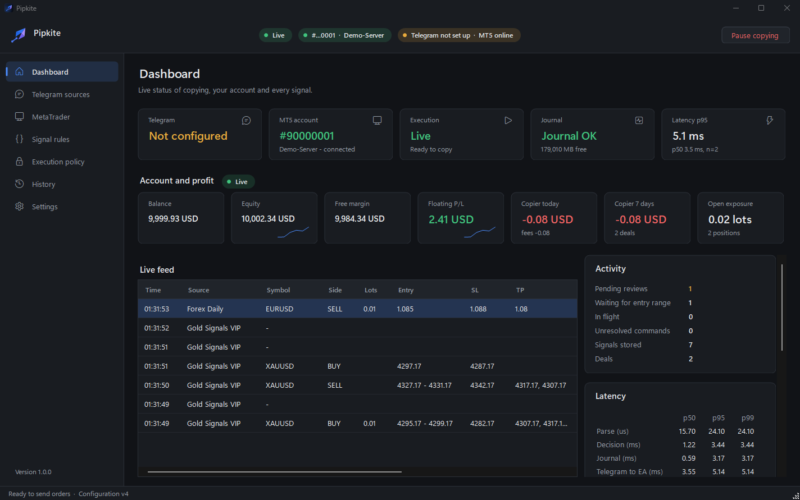

# Pipkite

Copy trading signals from Telegram to MetaTrader 5, automatically and fast (about 4 ms from message to order).
Free for everyone, including the AI review of every signal.



## What it does

- Reads new messages from the Telegram channels and groups you pick (your own account, private channels work).
- Each channel gets a parser built for its signal format. You request it from the app, it arrives as an update.
- Checks every signal against your rules: lot size or risk %, max spread, trading hours, entry ranges.
- Places the order in your MT5 terminal through the Pipkite EA.
- AI review on every signal: Good, Uncertain or Bad, with the reasons.
- Pause / resume copying with one click. Pausing never closes open trades.

## Get it

1. Download the installer from the website (or build it, see below). Windows 10/11, 64-bit.
2. Get a free license key on the website. It unlocks parsers, AI review and updates.
3. Follow the setup wizard: Telegram, MetaTrader 5, your channels, a test message.

Use a demo account first. No copier can guarantee fills or profits.

User guide: [docs/USER-GUIDE.md](docs/USER-GUIDE.md)

## Build from source

You need Visual Studio 2026 (C++ desktop + C++/CLI + .NET Framework 4.8 targeting pack).

```powershell
# app, engine, EA bridge, tests (Release x64)
MSBuild Pipkite.sln -p:Configuration=Release -p:Platform=x64 -m
x64\Release\Pipkite.Tests.exe

# installer + portable zip (needs Inno Setup)
powershell -ExecutionPolicy Bypass -File installer\package.ps1 -Build
```

Or open `Pipkite.sln` and press F5. More in [docs/DEVELOPMENT.md](docs/DEVELOPMENT.md).

## Repo layout

| Folder | What's in it |
|---|---|
| `Pipkite.WinForms` | the desktop UI |
| `Pipkite.Engine` | the engine: Telegram, parsing, decisions, orders, updates |
| `Pipkite.Core` | parser, rules, planner, AI client |
| `Pipkite.Storage` | local SQLite database and backups |
| `Pipkite.Protocol` | IPC, crypto, signing |
| `Pipkite.MT5BridgeHost` / `MT5BridgeImpl` | the DLL the EA talks to |
| `mql5/` | the MetaTrader 5 EA |
| `Pipkite.Tests` | tests (unit + end-to-end with a test MT5 terminal) |
| `frontend/` | the website |

## Contributing

Issues and pull requests are welcome. Keep changes small, run the tests before sending, and don't commit keys,
secrets or local data.

## License

MIT, see [LICENSE](LICENSE). Third-party notices: [third_party/THIRD_PARTY_NOTICES.md](third_party/THIRD_PARTY_NOTICES.md).
