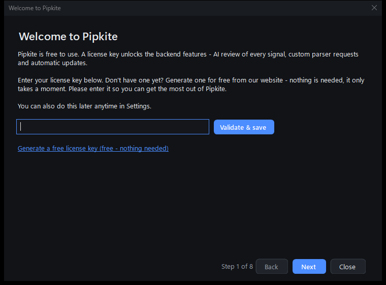
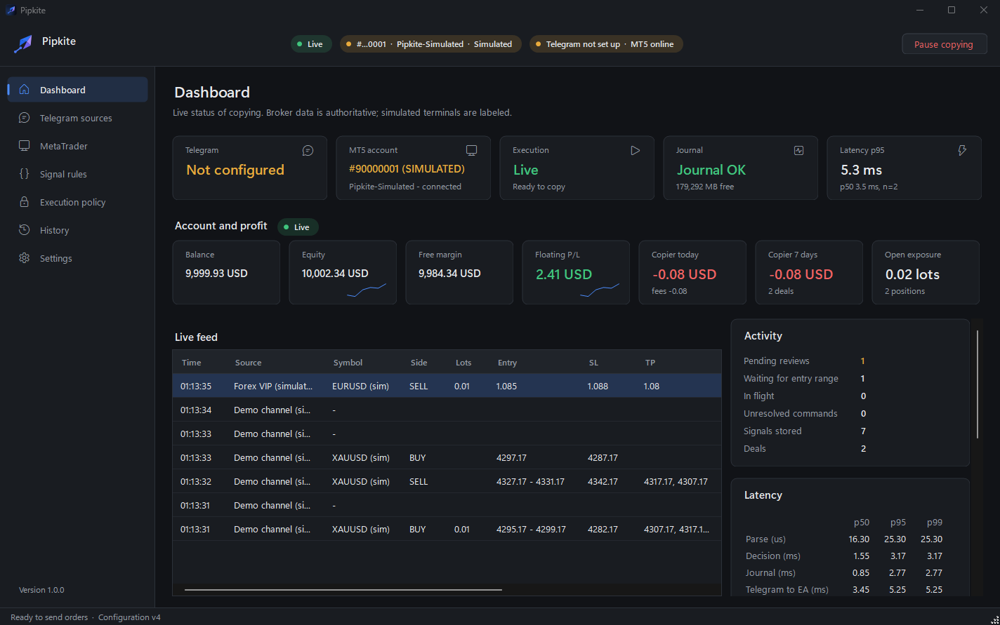
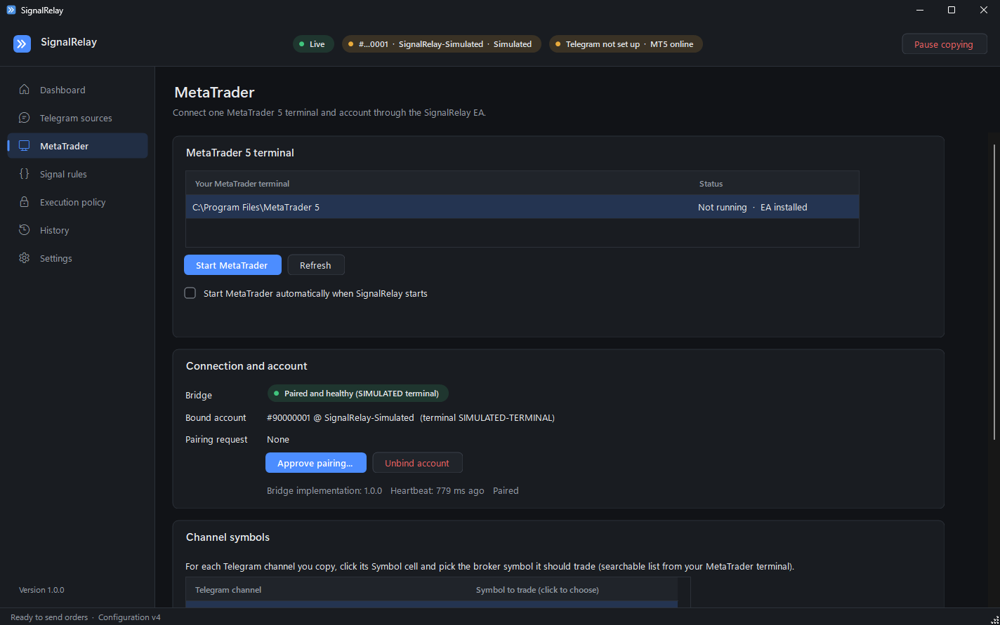
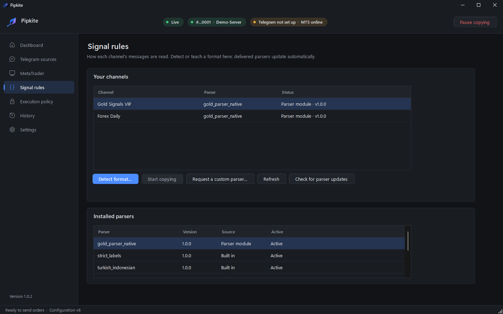
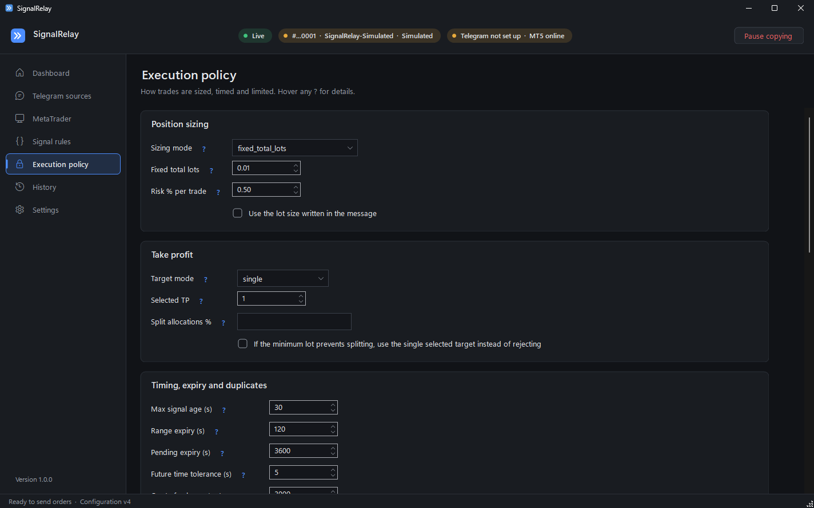
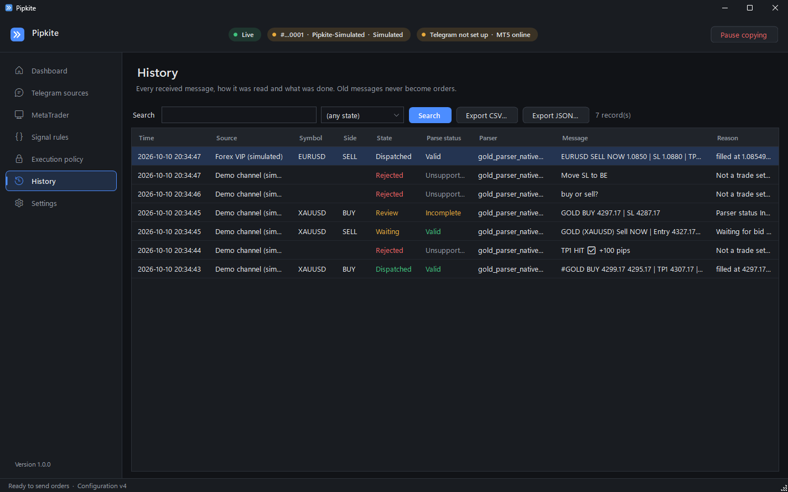

# Pipkite user guide

Pipkite copies trading signals from your Telegram channels into MetaTrader 5. This guide walks you through setup
and every screen. You don't need to know any programming.

**Contents:** [Before you start](#before-you-start) · [Setup](#setup-step-by-step) · [Screens](#screens) ·
[Updating](#updating) · [Pausing](#pausing) · [AI review](#ai-review) · [Your data](#your-data) · [Something wrong?](#something-wrong) ·
[Words you'll see](#words-youll-see)

## Before you start

Have these ready. It takes about 15 minutes in total.

- **A Windows 10 or 11 PC** (64-bit). Pipkite copies only while the PC is on. For 24/7, use a Windows VPS.
- **MetaTrader 5** (desktop version) from your broker, and a **demo account** to test with.
- **Your Telegram account**, already a member of the channels you want to copy. Private channels work.
- **A Telegram API ID and hash.** Free: sign in at [my.telegram.org](https://my.telegram.org), open
  **API development tools**, fill in any app name, and copy the two values.
- **A free Pipkite license key** from [pipkite.com/license](https://pipkite.com/license). It arrives by email.

## Setup step by step

The setup wizard opens on first launch and walks you through these steps. You can redo any of them later from
the menu on the left.

### 1. License key

Paste your key and click **Validate & save**. The status turns green.

The key is free and never expires. Without one, Pipkite still reads signals with its built-in formats, but the
AI review, shared formats, Pipkite's AI format help, custom parsers and updates are off.

### 2. Telegram

1. Paste your API ID and API hash and click **Save credentials**.
2. Enter your phone number with the country code (for example +44...) and click **Send code**.
3. Type the code Telegram sends you (usually inside the Telegram app). If you use a two-step password, enter it too.
4. Tick the channels and groups you want to copy and click **Add checked as sources**.

Only messages that arrive from now on are copied. Old messages never become trades.

### 3. MetaTrader 5

1. Click **Start MetaTrader**. Pipkite adds its EA (a small add-on) to MetaTrader and opens it. It asks first.
2. Log in to your broker inside MetaTrader as usual. **Use a demo account first.**
3. Back in Pipkite, click **Approve pairing** and type your account number to confirm.

MetaTrader not in the list? Click **Choose folder...** and pick the folder where it's installed.

Once an account is paired, Pipkite can trade on it. That's why the demo account comes first.

### 4. Signal format

Every channel writes its signals in its own way. Pipkite needs to know each channel's **format** before it can
copy it. On **Signal rules**, select a channel and click **Detect format**.

1. Paste one of the channel's signals under **Your example** and click **Check example**. Every format shows what
   it reads: symbol, side (Buy or Sell), entry, SL and TPs. The channel's recent messages are checked below.
2. Pick the format whose rows marked **Signal** are right, and click **Use this format**.
   - Rows marked **Review** or **Ignored** are never traded. That's fine for chat, results and news.
   - **Check price** means the price read is far from today's market: that reading is wrong.

Formats that come with Pipkite:

| Format | Good for |
|---|---|
| Universal | most signals in English, French, German, Italian, Spanish, Portuguese, Arabic, Persian, Russian; gold, forex, indices, crypto |
| Emoji labels | signals that use 🎯 for TP and 🛑 for SL |
| Comma decimals | prices written like 1,0850 |
| Thousands separators | prices written like 18,250 |
| Turkish & Indonesian | signals in those languages |
| Strict labels only | channels that always write "Entry:", "SL:", "TP:" |

Formats other Pipkite users made for the same channel are listed too, with how many people use them. They're
checked on your own messages like any other.

**None reads it right?** You have three options:

- **Teach Pipkite.** Under **Teach Pipkite**, select each part of your example with the mouse (the symbol, Buy or
  Sell, the entry, the SL, each TP) and press its button. Then click **Test on recent messages**. If the result
  looks right, use it. Pipkite only saves it if it reads your example the way you marked it.
- **Ask the AI.** Click **Ask AI for a format**. The AI suggests words to add, and you check the result the same
  way. Links, @names, phone numbers and emails are removed from the messages first. The AI never places or
  decides a trade.
- **Ask us.** Click **Request a custom parser**. We build one and it installs by itself, no restart.

Tick **Offer this format to other Pipkite users of this channel** to share what you taught or picked.

Until a channel has a format, its messages aren't traded.

### 5. Start copying

A new format doesn't trade right away. For a while, the channel's signals show in **History** with what Pipkite
would have done. When they read right, select the channel on **Signal rules** and click **Start copying**.

The same check comes back whenever a channel's format changes or gets a new version.

### 6. Your rules

On **Execution policy**, choose the lot size (or risk %) and set a **max spread and deviation for every symbol you
trade**. A symbol without them isn't traded. See [Execution policy](#screens) below.

**Tip:** before risking money, use **Test a sample** in the wizard: paste a real message and see what Pipkite
reads. Nothing is sent.

Until all of this is done, the Dashboard shows a **Get started** list with what's still missing and a button to
each step, and the top bar says **Not ready**.

## Screens

**Dashboard.** Whether Telegram and MetaTrader are connected, your balance and profit, a live feed of signals and
what happened to each, and how fast Pipkite was.

**Telegram sources.** Sign in, then tick the chats you want to copy.

**MetaTrader.** Start the terminal with the EA, approve pairing, and match each channel's symbol to your broker's
name for it (for example GOLD to XAUUSD).

**Signal rules.** Which format reads each channel. Detect, teach or ask the AI for one, or request a custom parser.
A channel marked **Not copying yet** has a new format: check its signals in History, then click **Start copying**.

**Execution policy.** How trades are placed. Every option has a **?** that explains it.

- **Size:** fixed lots, or a % of your equity risked at the stop-loss (always rounded down, never up).
- **Targets:** one take-profit, or the position split across several.
- **Limits:** how old a signal may be, max spread, slippage, open positions, daily loss, trading hours.
- **Entry ranges:** for "buy 4299-4295", Pipkite waits for the price to enter the range. **Force-enter** (off by
  default) still takes the trade if the price slipped just past it by a few pips.
- **AI review:** tick **Review every signal with AI** to see Good / Uncertain / Bad next to each signal.

**History.** Every message, how it was read and what was done, with the reason. Export to CSV or JSON. Open a
message Pipkite couldn't read and click **Teach Pipkite from this message...** to fix its channel's format from it.

**Settings.** Theme, start with Windows, how long data is kept, backups, license key, updates. Under **Signal
formats and AI help**: whether to look up and share formats with other users of a channel, and which AI helps with
formats (Pipkite's, or your own OpenAI, DeepSeek or other OpenAI-compatible key, stored encrypted on your PC).

## Updating

Each time Pipkite starts (and every few hours after), it checks for a new version. When there is one, a bar slides
in at the top of the window: **Pipkite X is available**.

- **Update now** downloads it, checks it's signed by Pipkite, closes Pipkite, installs the new version and opens it
  again. Copying stops for about a minute. Your settings, channels and history are kept, and open trades aren't
  touched.
- **What's new** opens the release notes. **Later** hides the bar until Pipkite starts again.
- The portable version shows **Download** instead: get the new zip and unzip it over the old folder.

Signal formats and parsers update by themselves, without this bar.

## Pausing

**Pause copying** (top bar or tray icon) stops new trades right away. It never closes anything: manage open trades
in MetaTrader as usual. **Resume copying** starts again.

Sleep, shutdown or a closed MetaTrader also pause copying.

## AI review

Each signal gets a verdict (**Good**, **Uncertain** or **Bad**) with reasons and a confidence score. It's advice:
it doesn't block trades. It's an early version, it can be wrong, and the score is not a promise of profit.

With MetaTrader connected, the review also reads the market: the trend on H4, H1 and M15, momentum, where the price
is now against the entry, SL and TP1, and the SL distance against volatility.

Only the signal (symbol, side, entry, SL, TPs) and recent price candles of that symbol (M1 to H4) are sent, never
your account or messages. The signal and its verdict are kept with your license key to help the AI learn.

## Your data

History, settings and your Telegram session (encrypted with Windows DPAPI) stay on your PC. Only what the online
services need is sent: the privacy page on the website has the full list. Your broker password stays in
MetaTrader, Pipkite never asks for it.

## Something wrong?

| You see | What to do |
|---|---|
| **Telegram: not set up** | Enter your API ID and hash, then sign in. |
| **MT5 offline** | MetaTrader is closed or the EA isn't on a chart. Click **Start MetaTrader** (close MT5 first if it's already open). |
| A signal shows **Unsupported** | That channel has no format yet. **Detect format** on Signal rules. |
| A signal shows **Rejected** or **Review** | Open the row in History to see why. Nothing was sent. |
| "New format for this channel, not copied yet" | The channel's format is new or changed. If the reading is right, click **Start copying** on Signal rules. |
| "Pipkite couldn't fully read 2 of its last 4 signals" | The channel may have changed how it writes signals. Run **Detect format** again. |
| The pairing never shows up | Start MetaTrader and log in to your broker first. |
| A symbol isn't traded | Give it a max spread and deviation on Execution policy, and check its name matches your broker's (MetaTrader screen). |
| SmartScreen warning on install | Click **More info**, then **Run anyway**. |

Settings has a **Run health check** button that checks everything at once.

## Words you'll see

| Word | Meaning |
|---|---|
| Signal | A trade idea posted in a channel: what to buy or sell, at what price, with SL and TP. |
| Symbol | What is traded, like XAUUSD (gold) or EURUSD. Brokers sometimes name it differently. |
| Side | Buy or Sell. |
| Entry | The price to open the trade at. A range like 4299-4295 means "anywhere in between". |
| SL (stop-loss) | The price where the trade closes to limit a loss. |
| TP (take-profit) | The price where the trade closes in profit. A signal can have several (TP1, TP2...). |
| Lot | The size of a trade in MetaTrader. |
| Spread | The gap between the buy and sell price. A wide spread makes a trade more expensive. |
| Format | How Pipkite reads one channel's way of writing signals. |
| EA (Expert Advisor) | A small add-on inside MetaTrader. Pipkite's EA places the orders. |
| Pairing | Linking Pipkite to one MetaTrader account, confirmed with the account number. |
| Demo account | A practice account with fake money. Test here first. |
