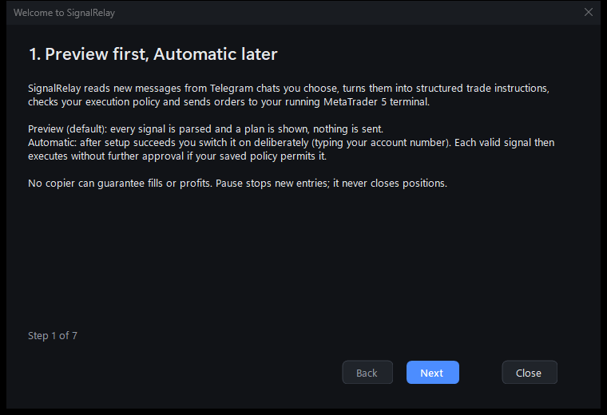
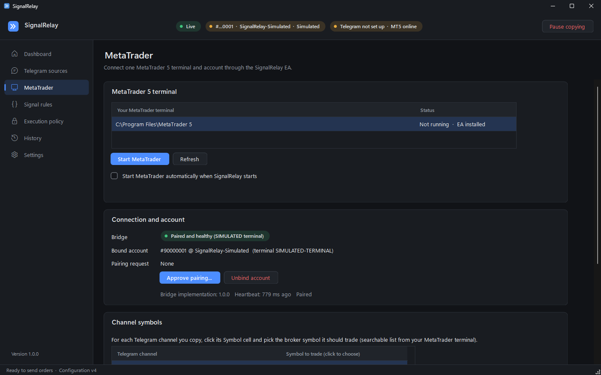
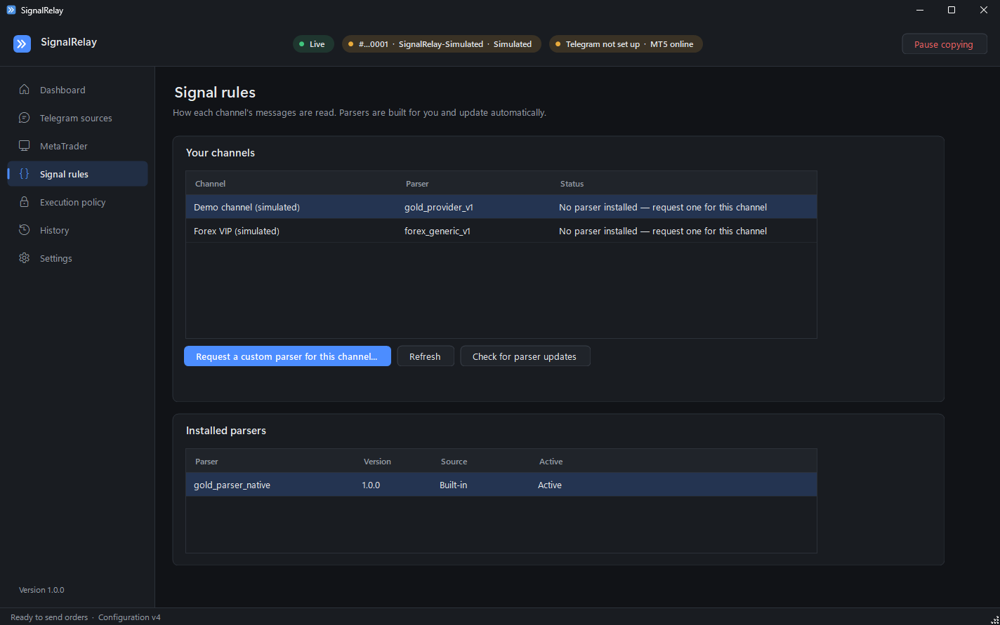
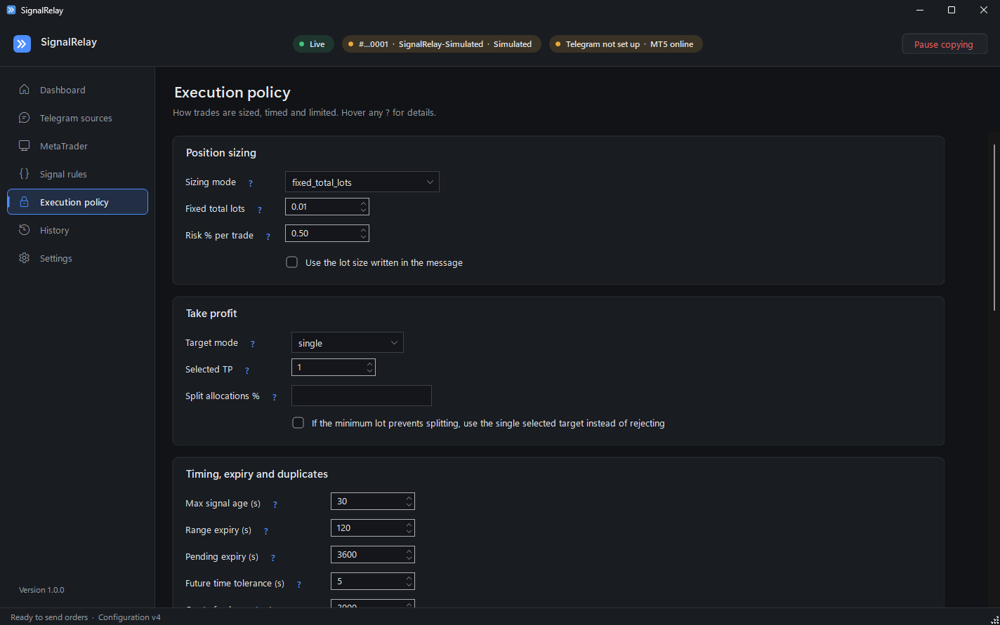
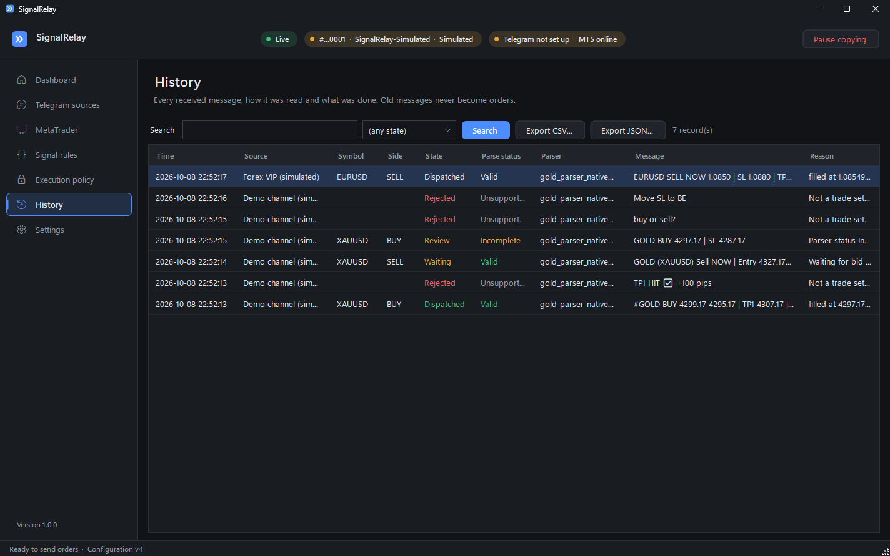

# SignalRelay user guide

## Setup in 5 steps

The setup wizard opens on first launch and walks you through these. You can redo any of it later from the menu.

1. **License key.** Paste your free key (get one on the website) and click **Validate & save**.
2. **Telegram.** Get an API ID and hash at my.telegram.org (API development tools), enter them, then your phone
   number and the code Telegram sends you.
3. **Channels.** Tick the channels and groups you want to copy. Only new messages are copied, never old ones.
4. **MetaTrader 5.** Click **Start MetaTrader**, log in to your broker, then approve the pairing with your account
   number. Use a demo account first: once an account is paired, copying is live.
5. **Parsers.** On **Signal rules**, select each channel and click **Request a custom parser**. We build one for that
   channel's format and it installs by itself, no restart. Until it arrives, that channel's messages aren't traded.

Before risking money, use **Test a sample** in the wizard: paste a real message and see what SignalRelay reads.
Nothing is sent.

## Screens

**Dashboard.** Connection status, balance and profit, the live feed of signals and what happened to each, and
the measured latency.

**Telegram sources.** Sign in, then tick the chats you want to copy.

**MetaTrader.** Start the terminal with the EA, approve pairing, and map each channel's symbol to your broker's
(for example GOLD to XAUUSD).

**Signal rules.** Which parser reads each channel, and the button to request one.

**Execution policy.** How trades are placed:

- size: fixed lots, or % of equity risked at the stop-loss (always rounded down)
- targets: one take-profit, or split across several
- limits: max signal age, spread, slippage, open positions, daily loss, trading hours
- entry ranges: waits for price to enter "buy 4299-4295" style ranges; **force-enter** (off by default) takes the
  trade if price slipped just past it by a few pips
- AI review: turn on "review every signal" to see Good / Uncertain / Bad next to each signal

Every symbol you trade needs a max spread and deviation, otherwise it isn't traded.

**History.** Every message, how it was read and what was done, with the reason. Export to CSV or JSON.

**Settings.** Theme, start with Windows, data retention, backups, license key, updates.

## Pausing

**Pause copying** (top bar or tray icon) stops new trades right away. It never closes anything: manage open
trades in MetaTrader as usual.

Sleep, shutdown or a closed MT5 also pause copying. For 24/7, run it on a Windows VPS.

## AI review

Each signal gets a verdict (Good, Uncertain or Bad) with reasons and a confidence score. It's advice: it doesn't
block trades. It's an early version, it can be wrong, and the score is not a promise of profit.
Only the signal fields are sent (symbol, side, entry, SL, TPs), never your account or messages.

## Your data

Everything stays on your PC: history, settings, your Telegram session (encrypted with Windows DPAPI). Your broker
password stays in MetaTrader, SignalRelay never asks for it.

## Something wrong?

- **Telegram: not set up**: enter your API ID/hash and sign in.
- **MT5 offline**: MetaTrader is closed or the EA isn't on a chart. Click Start MetaTrader (close MT5 first if it's
  already open).
- **Signal shows Unsupported**: that channel has no parser yet, request one on Signal rules.
- **Signal shows Rejected or Review**: open the row in History to see why. Nothing was sent.
- **Pairing never shows up**: start MetaTrader and log in to your broker first.
- **SmartScreen warning on install**: More info, Run anyway.

Settings has a **Run health check** button that checks everything at once.
