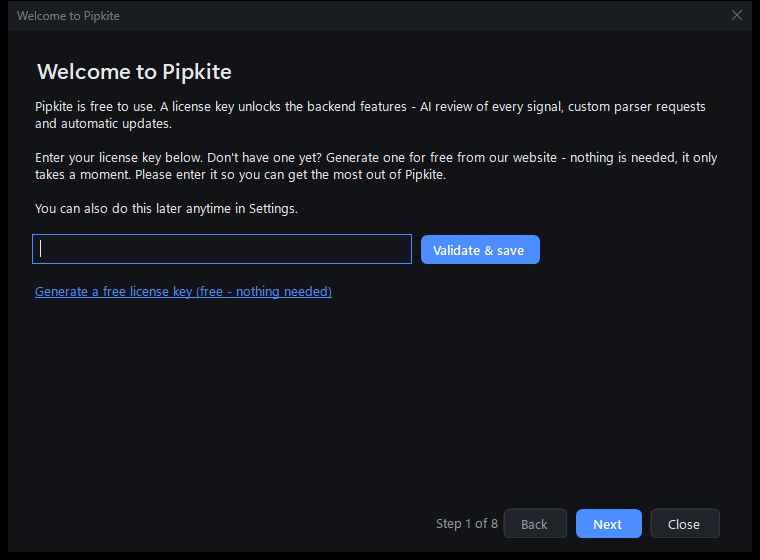
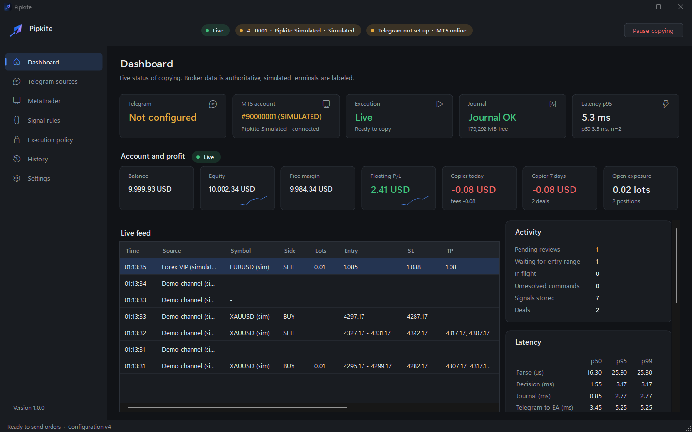
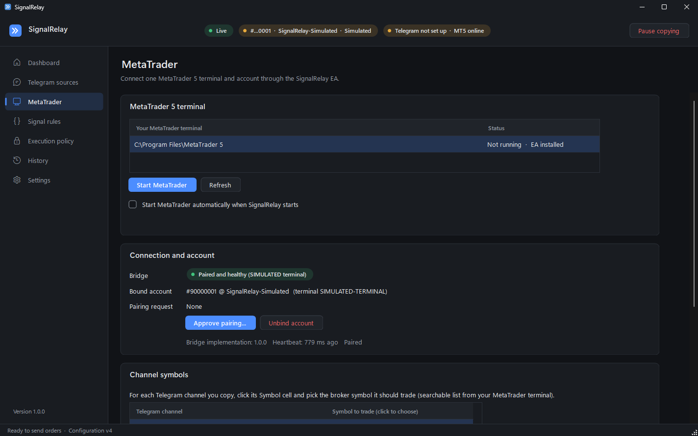
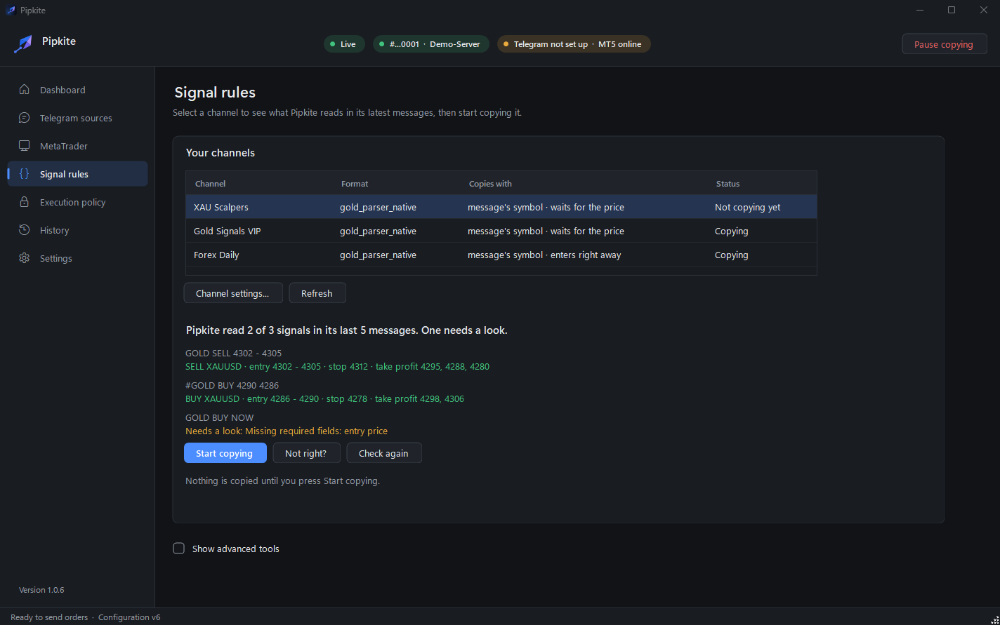
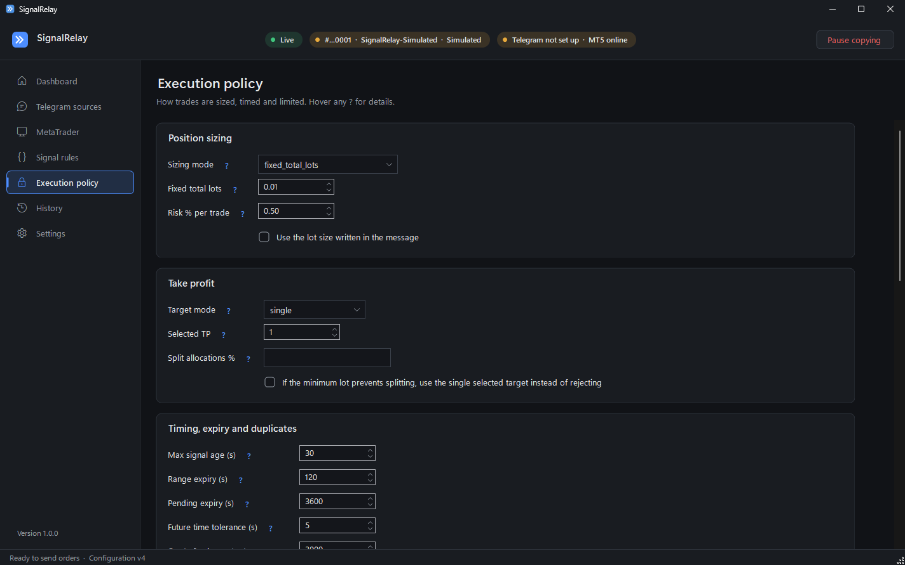
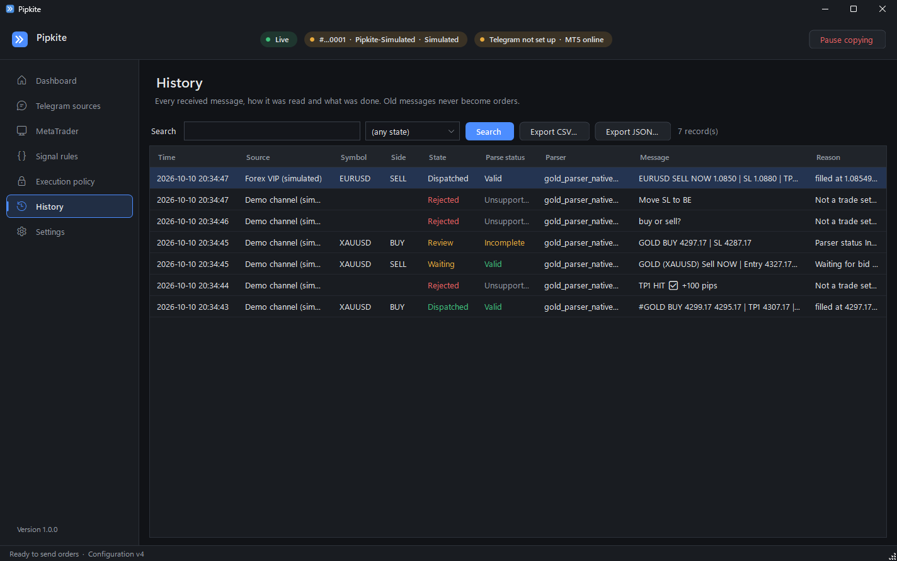

# Pipkite user guide

Pipkite copies trading signals from your Telegram channels into MetaTrader 5. This guide walks you through setup
and every screen. You don't need to know any programming.

**Contents:** [Before you start](#before-you-start) · [Setup](#setup-step-by-step) · [Screens](#screens) ·
[Updating](#updating) · [Pausing](#pausing) · [AI review](#ai-review) · [Your data](#your-data) · [Something wrong?](#something-wrong) ·
[Words you'll see](#words-youll-see)

## Before you start

Have these ready. It takes about 15 minutes in total.

- **A Windows 10 or 11 PC** (64-bit). Pipkite copies only while the PC is on. For 24/7, use a Windows VPS.
- **MetaTrader 5** (desktop version) from your broker, and a **demo account** to test with.
- **Your Telegram account**, already a member of the channels you want to copy. Private channels work.
- **A Telegram API ID and hash.** Free: sign in at [my.telegram.org](https://my.telegram.org), open
  **API development tools**, fill in any app name, and copy the two values.
- **A free Pipkite license key** from [pipkite.com/license](https://pipkite.com/license). It arrives by email.

## Setup step by step

The setup wizard opens on first launch and walks you through these steps. You can redo any of them later from
the menu on the left.

### 1. License key

Paste your key and click **Validate & save**. The status turns green.

The key is free and never expires. Without one, Pipkite still reads signals with its built-in formats, but the
AI review, shared formats, Pipkite's AI format help, custom parsers and updates are off.

### 2. Telegram

1. Paste your API ID and API hash and click **Save credentials**.
2. Enter your phone number with the country code (for example +44...) and click **Send code**.
3. Type the code Telegram sends you (usually inside the Telegram app). If you use a two-step password, enter it too.
4. Tick the channels and groups you want to copy. Right under the list, Pipkite shows what it reads in the chat you
   ticked (see [Signal format](#4-signal-format)). Unticking one pauses it and keeps its settings; tick it again to
   copy it as before.

Only messages that arrive from now on are copied. Old messages never become trades.

### 3. MetaTrader 5

1. Click **Start MetaTrader**. Pipkite adds its EA (a small add-on) to MetaTrader and opens it. It asks first.
2. Log in to your broker inside MetaTrader as usual. **Use a demo account first.**
3. Back in Pipkite, click **Approve pairing** and type your account number to confirm.

MetaTrader not in the list? Click **Choose folder...** and pick the folder where it's installed.

Once an account is paired, Pipkite can trade on it. That's why the demo account comes first.

### 4. Signal format

Every channel writes its signals in its own way. When you tick a channel, or select it on **Signal rules**, Pipkite
tries every format on its latest messages and shows the result in plain words: how many signals it read, and the
latest ones as it reads them (Buy or Sell, symbol, entry, stop and take profit). A message that looks like a signal
but isn't complete says **Needs a look** and why. It is never traded.

- **It reads them right?** Click **Start copying** (step 5).
- **Not right?** Click **Not right?** (**Show Pipkite a signal...** when it reads none). The format window opens:

1. Paste one of the channel's signals under **Your example** and click **Check example**. Every format shows what
   it reads: symbol, side (Buy or Sell), entry, SL and TPs. The channel's recent messages are checked below.
2. Pick the format whose rows marked **Signal** are right, and click **Use this format**.
   - Rows marked **Review** or **Ignored** are never traded. That's fine for chat, results and news.
   - **Check price** means the price read is far from today's market: that reading is wrong.

Formats that come with Pipkite:

| Format | Good for |
|---|---|
| Universal | most signals in English, French, German, Italian, Spanish, Portuguese, Arabic, Persian, Russian; gold, forex, indices, crypto |
| Emoji labels | signals that use 🎯 for TP and 🛑 for SL |
| Comma decimals | prices written like 1,0850 |
| Thousands separators | prices written like 18,250 |
| Turkish & Indonesian | signals in those languages |
| Strict labels only | channels that always write "Entry:", "SL:", "TP:" |

Formats other Pipkite users made for the same channel are listed too, with how many people use them. They're
checked on your own messages like any other.

**None reads it right?** You have three options:

- **Teach Pipkite.** Under **Teach Pipkite**, select each part of your example with the mouse (the symbol, Buy or
  Sell, the entry, the SL, each TP) and press its button. Then click **Test on recent messages**. If the result
  looks right, use it. Pipkite only saves it if it reads your example the way you marked it.
- **Ask the AI.** Click **Ask AI for a format**. The AI suggests words to add, and you check the result the same
  way. Links, @names, phone numbers and emails are removed from the messages first. The AI never places or
  decides a trade.
- **Ask us.** On **Signal rules**, tick **Show advanced tools** and click **Request a custom parser**. We build one
  and it installs by itself, no restart.

Tick **Offer this format to other Pipkite users of this channel** to share what you taught or picked.

Until a channel has a format, its messages aren't traded.

### 5. Start copying

Nothing is copied until you click **Start copying** under the channel's readings. It uses the format whose readings
you see, and from then on the channel's new signals are copied with your Execution policy and Symbol limits.

A format you picked or taught in the format window waits for **Start copying** too. Until then, the channel's
signals also show in **History** with what Pipkite would have done, without trading.

The same check comes back whenever a channel's format changes or gets a new version: the channel shows **Not copying
yet** until you click **Start copying** again.

### 6. Your rules

On **Execution policy**, set a **max spread and deviation for every symbol you trade** in **Symbol limits**, at the
top: pick the symbol from the list, fill in its limits (or click **Use suggested limits** for common symbols like gold
and the main currency pairs, then check them), and click **Save policy**. A symbol without a max spread
isn't traded. Then choose the lot size (or risk %). See [Execution policy](#screens) below.

Pick each symbol under its own broker name (for example `XAUUSD.m`, `GOLD#` or `US30.cash`): that's also how
Pipkite knows where a channel's GOLD or US30 signals go. If two names for the same instrument are set, Pipkite asks you
to keep one.

Execution policy applies to every channel. A channel can have its own settings on **Signal rules → Channel
settings**:

- **Broker symbol:** only for a channel that posts one instrument. Its signals trade that symbol, and a message for
  another symbol is skipped. Otherwise each message trades its own symbol.
- **How it enters:** **Wait for the entry price** (the default: Pipkite waits until the price is inside the
  message's entry range), **Enter right away** (NOW signals with a price, while they are fresh), or **Pending orders
  only** (LIMIT / STOP messages become pending orders). Every mode uses the symbol's **Entry deviation**.

A trade needs a real setup: an entry price, a stop loss and a take profit. BUY NOW or SELL NOW without a price goes
to Review and is never traded.
- **Position sizing** and **Take profit:** follow Execution policy, or give this channel its own.

**Trading hours** can run overnight: 22:00 to 06:00 copies from 10 pm to 6 am.

**Max stop distance** (optional, per symbol, 0 = off) keeps every stop loss within that distance of the entry price.
For gold, 20.00 means the stop is never more than $20 away: if the message's stop is further, Pipkite uses the closer
one; a closer stop in the message is always kept, never widened. If your broker won't accept the stop, the trade is
skipped. The distance is measured from the price when the order is sent. With **Risk %** sizing a closer stop means
more lots for the same risk.

A signal without a stop loss is never traded, unless you tick **Trade signals without a stop loss, using the
symbol's max stop distance**. Then such a signal is traded only if everything else is clear, its symbol has a max stop
distance, and the message doesn't say the stop is still to come ("SL: soon"). History shows where the stop came from.

**Tip:** before risking money, use **Test a sample** in the wizard: paste a real message and see what Pipkite
reads. Nothing is sent.

Until all of this is done, the Dashboard shows a **Get started** list with what's still missing and a button to
each step, and the top bar says **Not ready**.

## Screens

The first time you open a page, a short tour points at each button and says what it does. Click **Next**, or
**Skip tour** to close it. Each tour shows once; **Settings → Show page tours again** brings them back.

**Dashboard.** Whether Telegram and MetaTrader are connected, your balance and profit, a live feed of the signals
that were accepted or are still running, and how fast Pipkite was. Rejected, ignored and held signals are in **History**.

**Telegram sources.** Sign in, then tick the chats you want to copy. The sign-in shows one step at a time. The chat
you tick shows what Pipkite reads in it, with **Start copying**.

**MetaTrader.** Start the terminal with the EA and approve pairing. **Channel symbols** pins a one-instrument channel
to a broker symbol (pick **each message's own symbol** to undo it). **Close Pipkite positions** and **Cancel Pipkite
pending orders** close or cancel only what Pipkite placed, after you type the account number.

**Signal rules.** Your channels and whether each one is copying. Select one to see what Pipkite reads in its latest
messages, then click **Start copying**, or **Not right?** to pick another format or teach one. **Channel settings**
changes one channel's symbol, entry and sizing. **Show advanced tools** has Detect format, Request a custom parser,
Check for parser updates and the installed parsers.

**Execution policy.** How trades are placed. Every option has a **?** that explains it.

- **Size:** fixed lots, or a % of your equity risked at the stop-loss (always rounded down, never up).
- **Targets:** one take-profit, or the position split across several. Targets the price has already passed when the
  trade opens (a take-profit inside the entry zone) are left out, and the next one is used.
- **Stop loss:** a max stop distance per symbol, and (off by default) trading signals that have no stop loss.
- **Limits:** how old a signal may be, max spread, slippage, open positions, daily loss, trading hours.
- **Entry ranges:** for "buy 4299-4295", Pipkite waits for the price to enter the range. **Force-enter** (off by
  default) still takes the trade if the price slipped just past it by a few pips.
- **AI review:** tick **Review every signal with AI** to see Good / Uncertain / Bad next to each signal.

**History.** Every message, how it was read and what was done, with the reason. Export to CSV or JSON. Open a
message Pipkite couldn't read and click **Teach Pipkite from this message...** to fix its channel's format from it.

**Settings.** Theme, start with Windows, how long data is kept, backups, license key, updates. Under **Signal
formats and AI help**: whether to look up and share formats with other users of a channel, and which AI helps with
formats (Pipkite's, or your own OpenAI, DeepSeek or other OpenAI-compatible key, stored encrypted on your PC). Under
**Diagnostics and connection**: **Keep a detailed log for troubleshooting** and **Open log folder** (see
[Something wrong?](#something-wrong)).

## Updating

Each time Pipkite starts (and every few hours after), it checks for a new version. When there is one, a bar slides
in at the top of the window: **Pipkite X is available**.

- **Update now** downloads it, checks it's signed by Pipkite, closes Pipkite, installs the new version and opens it
  again. Copying stops for about a minute. Your settings, channels and history are kept, and open trades aren't
  touched.
- **What's new** opens the release notes. **Later** hides the bar until Pipkite starts again.
- The portable version shows **Download** instead: get the new zip and unzip it over the old folder.

Signal formats and parsers update by themselves, without this bar.

## Pausing

**Pause copying** (top bar or tray icon) stops new trades right away. It never closes anything: manage open trades
in MetaTrader as usual. **Resume copying** starts again.

Sleep, shutdown or a closed MetaTrader also pause copying.

## AI review

Each signal gets a score and a verdict with reasons. The score is the estimated chance that price reaches TP1 before
the stop loss, measured from where Pipkite enters: a TP1 half as far as the stop is reached first about two times in
three. **Good** means 60% or more, **Bad** 40% or less, **Uncertain** in between. A far TP1 pays more but is reached
first less often, so it can be Bad even when the reward is big. It's advice: it doesn't block trades. It's an
estimate, it can be wrong, and it's not a promise of profit.

With MetaTrader connected, the market moves that chance a little: the trend on H4, H1 and M15, an overextended or
pulled-back entry, and the stop and TP1 against the recent H1 range. The review also warns about a very tight or very
wide stop and a spread that takes much of the stop or of the move to TP1. Without MetaTrader it can only use the
signal's distances, so it says **Uncertain** at best.

Only the signal (symbol, side, entry, SL, TPs) and recent price candles of that symbol (M1 to H4) are sent, never
your account or messages. The signal and its verdict are kept with your license key to help the AI learn.

## Your data

History, settings and your Telegram session (encrypted with Windows DPAPI) stay on your PC. Only what the online
services need is sent: the privacy page on the website has the full list. Your broker password stays in
MetaTrader, Pipkite never asks for it. The detailed log (off unless you tick it) stays on your PC too. Its files are
deleted after the message text retention days, and by **Erase local history**.

## Something wrong?

| You see | What to do |
|---|---|
| **Telegram: not set up** | Enter your API ID and hash, then sign in. |
| **MT5 offline** | MetaTrader is closed or the EA isn't on a chart. Click **Start MetaTrader** (close MT5 first if it's already open). |
| A signal shows **Unsupported** | That channel has no format yet. Select it on Signal rules: if Pipkite reads it right, click **Start copying**. |
| A signal shows **Rejected** or **Review** | Open the row in History to see why. Nothing was sent. |
| "New format for this channel, not copied yet" | The channel's format is new or changed. Select it on Signal rules; if the reading is right, click **Start copying**. |
| "Pipkite couldn't fully read 2 of its last 4 signals" | The channel may have changed how it writes signals. Select it on Signal rules and click **Not right?**. |
| "Pipkite found no recent messages in this channel" | Check that Telegram is signed in and that you ticked the channel that posts the signals, not its comments or direct-messages chat (it often has the same name). |
| The pairing never shows up | Start MetaTrader and log in to your broker first. |
| A symbol isn't traded | On Execution policy, pick it under **Symbol limits** and give it a max spread and deviation. |
| "The message is for EURUSD, but this channel trades only XAUUSD.m" | The channel is pinned to one symbol. If it posts several, set it to **each message's own symbol** in Channel settings. |
| "Missing required fields: entry price" | The message has no entry price, like BUY NOW alone. Pipkite only trades a setup with an entry price, a stop loss and a take profit. |
| SmartScreen warning on install | Click **More info**, then **Run anyway**. |

Settings has a **Run health check** button that checks everything at once.

Still not working as it should? Tick **Settings → Keep a detailed log for troubleshooting**, let it happen again,
then click **Open log folder** and send that day's file (`pipkite-<date>.log`) to Pipkite support. The log holds the
messages Pipkite received, what it read in them, why it traded or not, the orders and MetaTrader's replies, and what
you did in the window. It never holds passwords, login codes or keys. Untick it when you're done.

On the Pipkite website, select **Contact Us** in the navigation or footer. Use the form to send a support request
and get a reference number. The troubleshooting guide and [support@pipkite.com](mailto:support@pipkite.com) are
below the form.

## Words you'll see

| Word | Meaning |
|---|---|
| Signal | A trade idea posted in a channel: what to buy or sell, at what price, with SL and TP. |
| Symbol | What is traded, like XAUUSD (gold) or EURUSD. Brokers sometimes name it differently. |
| Side | Buy or Sell. |
| Entry | The price to open the trade at. A range like 4299-4295 means "anywhere in between". |
| SL (stop-loss) | The price where the trade closes to limit a loss. |
| TP (take-profit) | The price where the trade closes in profit. A signal can have several (TP1, TP2...). |
| Lot | The size of a trade in MetaTrader. |
| Spread | The gap between the buy and sell price. A wide spread makes a trade more expensive. |
| Format | How Pipkite reads one channel's way of writing signals. |
| EA (Expert Advisor) | A small add-on inside MetaTrader. Pipkite's EA places the orders. |
| Pairing | Linking Pipkite to one MetaTrader account, confirmed with the account number. |
| Demo account | A practice account with fake money. Test here first. |
